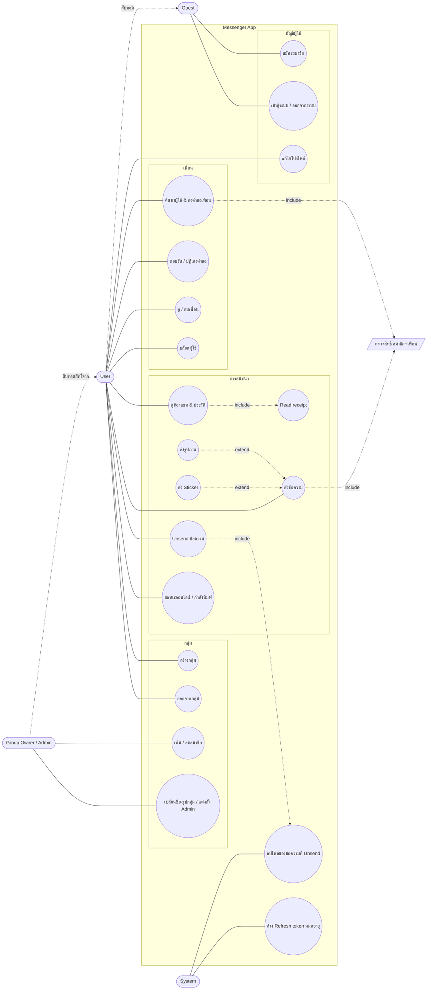

# 02 – Use Case Diagram

## ตารางความสัมพันธ์

| Use case | Actor | ความสัมพันธ์ |
| :--- | :--- | :--- |
| ส่งรูปภาพ, ส่ง Sticker | User | «extend» ส่งข้อความ |
| ส่งข้อความ | User | «include» ตรวจสิทธิ์ (เป็นสมาชิกห้อง + เป็นเพื่อน/ไม่ถูกบล็อก) |
| ดูห้องแชท & ประวัติ | User | «include» Read receipt |
| Unsend ข้อความ | User | «include» ลบไฟล์แนบ (System) |
| เพิ่ม/ลบสมาชิก, แต่งตั้ง Admin | Group Owner/Admin | ต้องมีบทบาท Owner/Admin ในกลุ่มนั้น |
