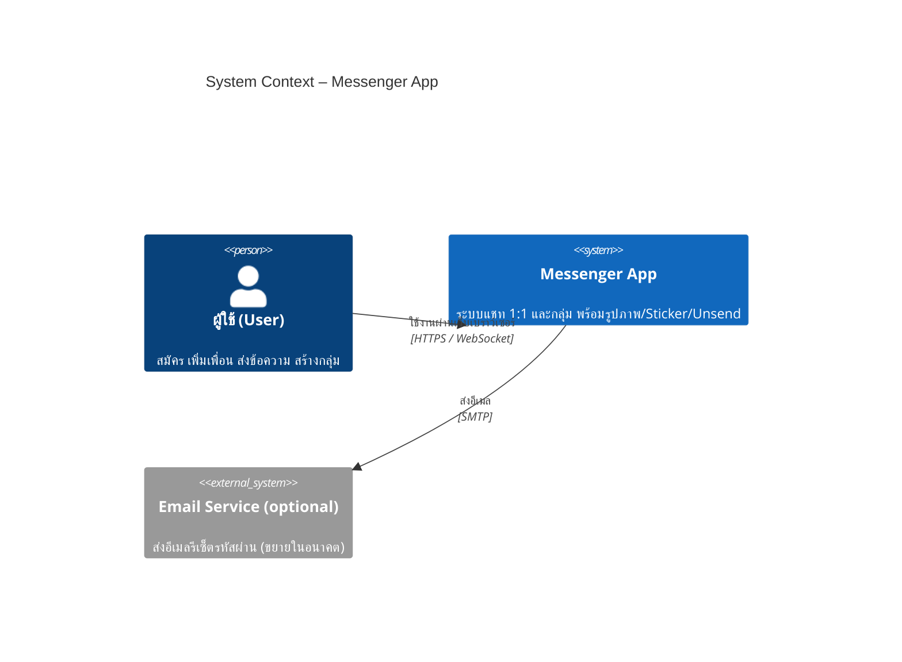
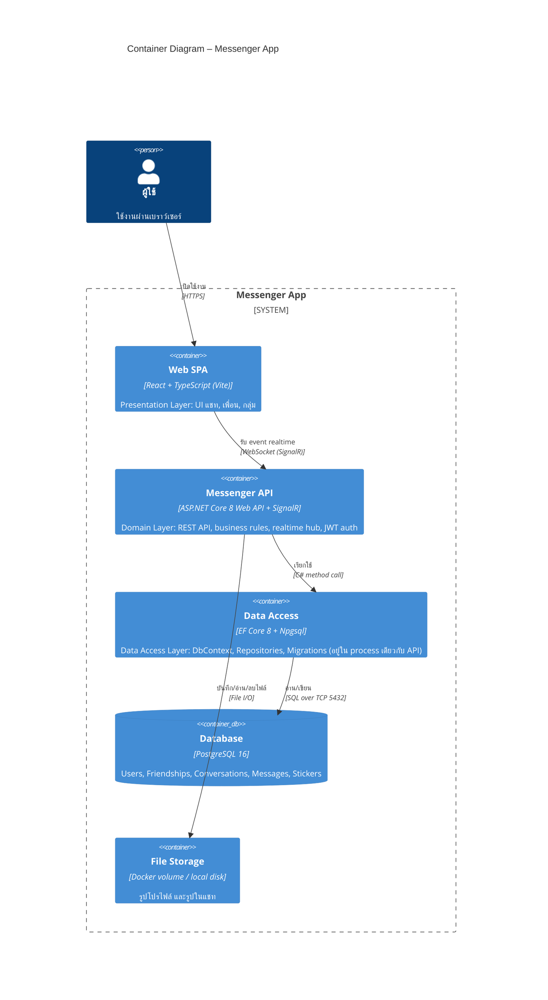
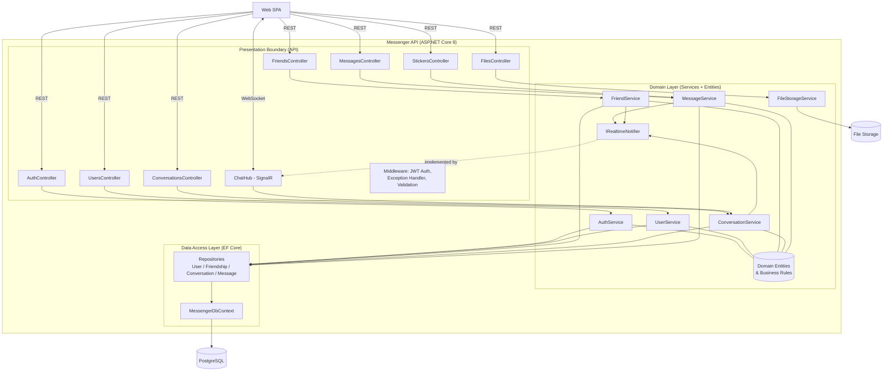
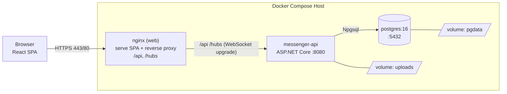

# 03 – สถาปัตยกรรมระบบ (C4 Model)

ใช้ C4 Model 4 ระดับ: Context → Container → Component → Deployment (Code level ดูที่ [Class Diagram](04-class-diagram.md))

## Level 1 – System Context

## Level 2 – Container

## Level 3 – Component (Messenger API)

### หน้าที่ของแต่ละ Component

| Component | หน้าที่ |
| :--- | :--- |
| Controllers | รับ HTTP, map DTO, เรียก Service, คืน status code (ไม่มี business logic) |
| ChatHub | จัดการ WebSocket: join group ของห้อง/ผู้ใช้, typing, presence |
| IRealtimeNotifier | Abstraction ให้ Domain ส่ง event โดยไม่ผูกกับ SignalR (ลด coupling, ทดสอบง่าย) |
| Services | Business rules ทั้งหมด (เช็คเป็นเพื่อน, สิทธิ์ในกลุ่ม, กฎ unsend ฯลฯ) |
| Repositories + DbContext | Query/Persist ด้วย EF, Migration, ไม่มี business rule |
| FileStorageService | ตรวจชนิดไฟล์/ขนาด, ตั้งชื่อไฟล์ด้วย GUID, บันทึก/ลบ |

## Deployment

หมายเหตุ: ถ้าต้องการ scale API หลาย instance ให้เพิ่ม Redis backplane สำหรับ SignalR (นอกขอบเขตโจทย์)
