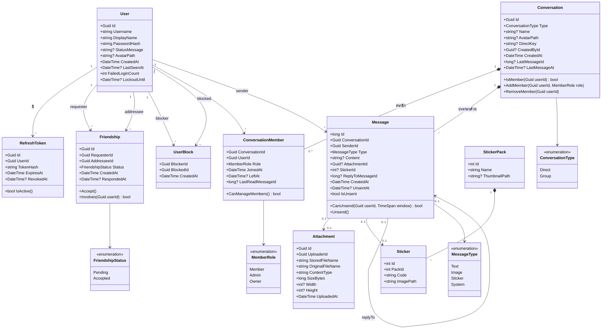
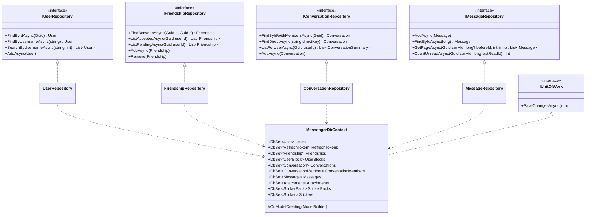

# 04 – Class Diagram

แบ่งเป็น 3 ส่วนตามเลเยอร์: Domain model, Service (Domain layer), Data access

## 1. Domain Model (Entities)

## 2. Service Layer (Domain Layer) และ Controllers

```mermaid
classDiagram
    direction LR

    class IAuthService {
        <<interface>>
        +RegisterAsync(RegisterDto) AuthResultDto
        +LoginAsync(LoginDto) AuthResultDto
        +RefreshAsync(string refreshToken) AuthResultDto
        +LogoutAsync(string refreshToken)
    }
    class IUserService {
        <<interface>>
        +GetProfileAsync(Guid id) UserDto
        +UpdateProfileAsync(Guid id, UpdateProfileDto) UserDto
        +SearchAsync(Guid me, string username) List~UserDto~
        +BlockAsync(Guid me, Guid target)
        +UnblockAsync(Guid me, Guid target)
    }
    class IFriendService {
        <<interface>>
        +SendRequestAsync(Guid me, Guid target) FriendshipDto
        +AcceptAsync(Guid me, Guid friendshipId)
        +DeclineAsync(Guid me, Guid friendshipId)
        +CancelAsync(Guid me, Guid friendshipId)
        +RemoveFriendAsync(Guid me, Guid friendId)
        +ListFriendsAsync(Guid me) List~FriendDto~
        +ListRequestsAsync(Guid me) FriendRequestsDto
        +AreFriendsAsync(Guid a, Guid b) bool
    }
    class IConversationService {
        <<interface>>
        +ListAsync(Guid me) List~ConversationDto~
        +GetOrCreateDirectAsync(Guid me, Guid friendId) ConversationDto
        +CreateGroupAsync(Guid me, CreateGroupDto) ConversationDto
        +UpdateGroupAsync(Guid me, Guid id, UpdateGroupDto)
        +AddMembersAsync(Guid me, Guid id, List~Guid~)
        +RemoveMemberAsync(Guid me, Guid id, Guid target)
        +LeaveAsync(Guid me, Guid id)
        +SetRoleAsync(Guid me, Guid id, Guid target, MemberRole)
        +MarkReadAsync(Guid me, Guid id, long messageId)
    }
    class IMessageService {
        <<interface>>
        +SendAsync(Guid me, Guid convId, SendMessageDto) MessageDto
        +GetHistoryAsync(Guid me, Guid convId, long? beforeId, int limit) List~MessageDto~
        +UnsendAsync(Guid me, long messageId)
        +ListStickersAsync() List~StickerPackDto~
    }
    class IFileStorageService {
        <<interface>>
        +SaveImageAsync(Guid me, IFormFile) AttachmentDto
        +OpenReadAsync(Guid attachmentId) Stream
        +DeleteAsync(Guid attachmentId)
    }
    class IRealtimeNotifier {
        <<interface>>
        +NotifyMessageReceived(IEnumerable~Guid~ userIds, MessageDto)
        +NotifyMessageUnsent(Guid convId, long messageId)
        +NotifyFriendEvent(Guid userId, string type, FriendshipDto)
        +NotifyConversationChanged(IEnumerable~Guid~ userIds, ConversationDto)
        +NotifyRead(Guid convId, Guid userId, long messageId)
    }
    class ITokenService {
        <<interface>>
        +CreateAccessToken(User) string
        +CreateRefreshToken() string
    }

    class AuthService
    class UserService
    class FriendService
    class ConversationService
    class MessageService
    class FileStorageService
    class SignalRNotifier

    IAuthService <|.. AuthService
    IUserService <|.. UserService
    IFriendService <|.. FriendService
    IConversationService <|.. ConversationService
    IMessageService <|.. MessageService
    IFileStorageService <|.. FileStorageService
    IRealtimeNotifier <|.. SignalRNotifier

    AuthService ..> ITokenService
    MessageService ..> IFriendService : ตรวจเป็นเพื่อน
    MessageService ..> IRealtimeNotifier
    MessageService ..> IFileStorageService : ลบไฟล์ตอน unsend
    FriendService ..> IRealtimeNotifier
    ConversationService ..> IFriendService
    ConversationService ..> IRealtimeNotifier

    class AuthController
    class UsersController
    class FriendsController
    class ConversationsController
    class MessagesController
    class FilesController
    class StickersController
    class ChatHub {
        +OnConnectedAsync()
        +OnDisconnectedAsync(Exception)
        +Typing(Guid convId)
        +JoinConversation(Guid convId)
    }

    AuthController ..> IAuthService
    UsersController ..> IUserService
    FriendsController ..> IFriendService
    ConversationsController ..> IConversationService
    MessagesController ..> IMessageService
    FilesController ..> IFileStorageService
    StickersController ..> IMessageService
    ChatHub ..> IConversationService
    SignalRNotifier ..> ChatHub : IHubContext
```

## 3. Data Access Layer

## 4. DTO หลัก

| DTO | ฟิลด์ |
| :--- | :--- |
| `RegisterDto` | username, displayName, password |
| `AuthResultDto` | accessToken, refreshToken, expiresIn, user |
| `UserDto` | id, username, displayName, statusMessage, avatarUrl |
| `FriendDto` | user: UserDto, isOnline, conversationId |
| `FriendshipDto` | id, requester: UserDto, addressee: UserDto, status |
| `ConversationDto` | id, type, name, avatarUrl, members, lastMessage, unreadCount |
| `SendMessageDto` | type, content?, attachmentId?, stickerId?, replyToMessageId? |
| `MessageDto` | id, conversationId, sender, type, content (null ถ้า unsent), attachmentUrl, sticker, replyTo, createdAt, isUnsent |

## 5. หลักการออกแบบ
- **Dependency Inversion:** Controller → Interface ของ Service; Service → Interface ของ Repository/Notifier
- **Rich domain:** กฎเล็กๆ อยู่ใน Entity (`Message.CanUnsend`, `ConversationMember.CanManageMembers`) กฎที่ข้าม entity อยู่ใน Service
- **DTO แยกจาก Entity:** ไม่ส่ง `PasswordHash` ออกไป และ mask เนื้อหาเมื่อ `IsUnsent`
