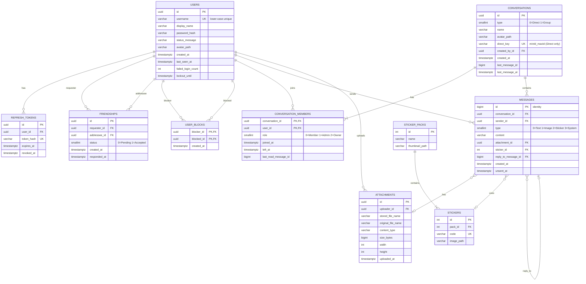

# 05 – ER Diagram และ Database Schema (PostgreSQL)



## Constraints และ Index

| ตาราง | Constraint / Index | วัตถุประสงค์ |
| :--- | :--- | :--- |
| users | `UNIQUE (lower(username))` | username ไม่ซ้ำ |
| friendships | `UNIQUE (LEAST(requester_id,addressee_id), GREATEST(requester_id,addressee_id))`; `CHECK (requester_id <> addressee_id)` | หนึ่งคู่ = หนึ่ง record |
| friendships | index `(addressee_id, status)` | ดึงคำขอที่รอตอบ |
| conversations | `UNIQUE (direct_key)` (nullable) | ห้อง 1:1 ไม่ซ้ำ |
| conversation_members | index `(user_id)` | ดึงห้องของผู้ใช้ |
| messages | index `(conversation_id, id DESC)` | cursor pagination ประวัติแชท |
| messages | `CHECK (type <> 0 OR content IS NOT NULL)` | ข้อความ text ต้องมีเนื้อหา |
| refresh_tokens | index `(user_id)`, `UNIQUE (token_hash)` | |

## Query ที่สำคัญ

```sql
-- ประวัติข้อความ (cursor)
SELECT * FROM messages
WHERE conversation_id = @cid AND (@before IS NULL OR id < @before)
ORDER BY id DESC LIMIT 30;

-- unread count ต่อห้อง
SELECT COUNT(*) FROM messages m
WHERE m.conversation_id = @cid AND m.id > COALESCE(@lastRead, 0)
  AND m.sender_id <> @me AND m.unsent_at IS NULL;
```

## Seed Data
- `sticker_packs` / `stickers`: seed อย่างน้อย 1 pack (8–16 รูป) ผ่าน `HasData()` ใน EF
