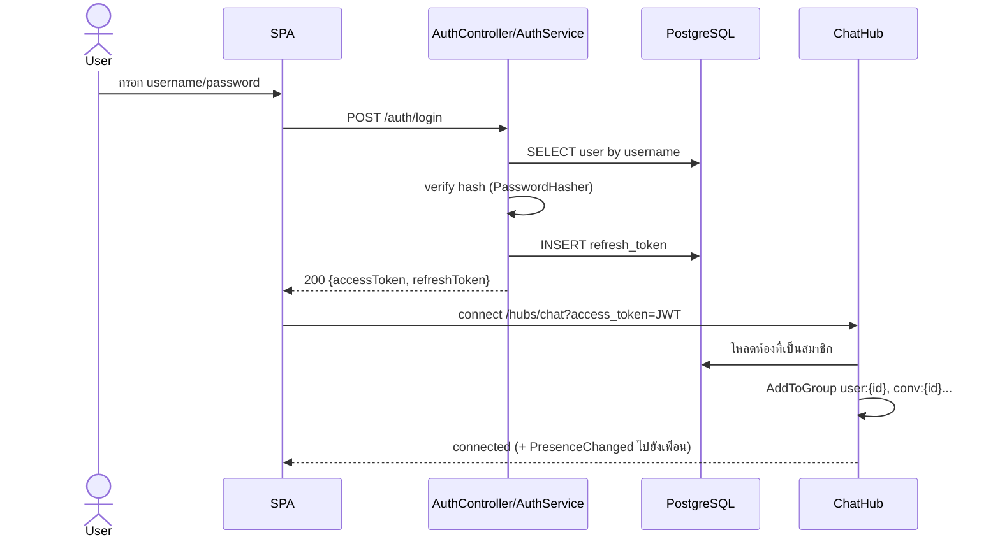
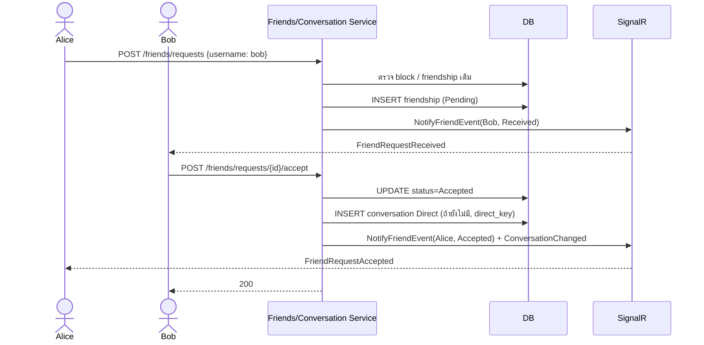
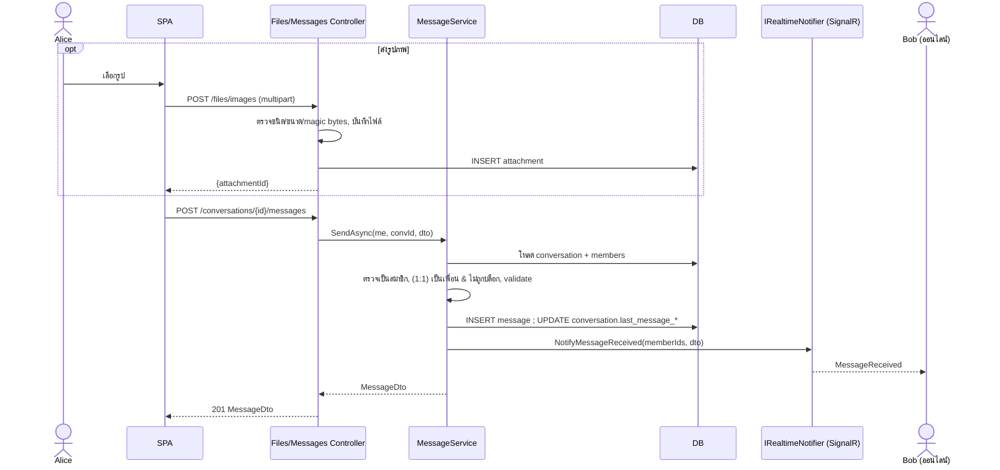
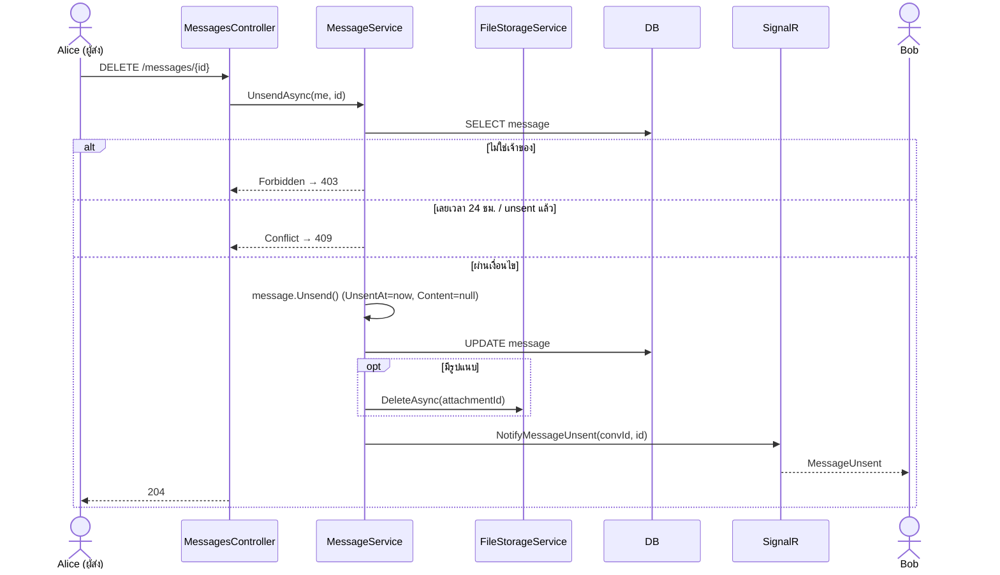
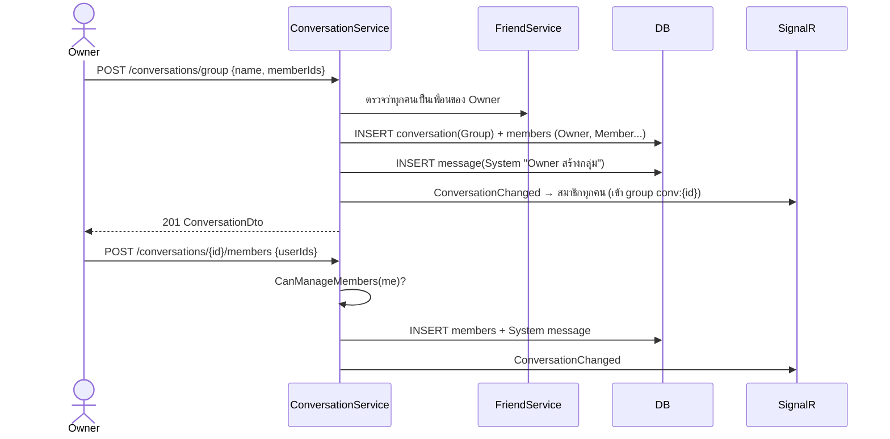
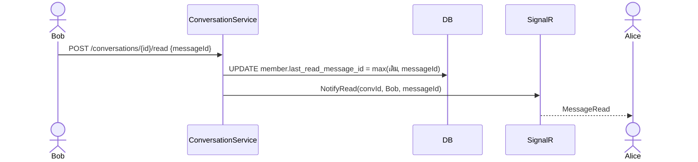

# 07 – Sequence Diagrams

## 1. เข้าสู่ระบบและเชื่อม Realtime

## 2. ส่งคำขอเป็นเพื่อนและตอบรับ

## 3. ส่งข้อความ (รวมรูปภาพ)

## 4. Unsend ข้อความ

## 5. สร้างกลุ่มและเพิ่มสมาชิก

## 6. อ่านข้อความ (Read receipt)

