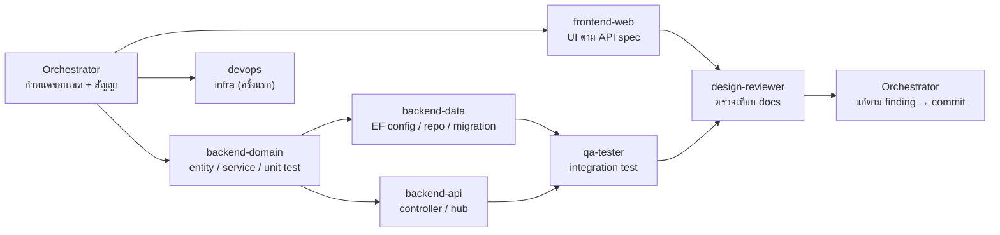

# 09 – Agent Team สำหรับพัฒนาโปรเจกต์

ทีม AI subagent ที่ใช้พัฒนา Messenger App นิยามไว้ใน `.claude/agents/*.md` และกฎกลางอยู่ใน `CLAUDE.md`
หลักการคือ **หนึ่ง agent ต่อหนึ่งเลเยอร์/พื้นที่ไฟล์** ตรงกับสถาปัตยกรรม (Api → Domain ← Data) เพื่อไม่ให้ agent เขียนไฟล์ทับกัน
และให้ทีมผู้พัฒนาตรวจและอธิบายโค้ดแต่ละส่วนได้ (ตามเงื่อนไขการใช้ AI ของโจทย์)

## 1. สมาชิกทีม

| Agent | ความรับผิดชอบ | พื้นที่ที่แก้ไขได้ | Model |
| :--- | :--- | :--- | :--- |
| **Orchestrator** (session หลัก) | แตกงานตาม iteration, กำหนดสัญญา (interface/DTO), สั่งงาน, รวมงาน, ตัดสินเมื่อ design ขัดกัน | `Messenger.sln`, `docs/decisions.md` | – |
| `backend-domain` | Entity, DTO, Exception, Service + business rules ทั้งหมด, unit test | `src/Messenger.Domain`, `tests/Messenger.Domain.Tests` | sonnet |
| `backend-data` | DbContext, Configuration, Repository, Migration, Seed | `src/Messenger.Data` | sonnet |
| `backend-api` | Program.cs, JWT, Controllers, ChatHub/SignalRNotifier, Middleware, File upload | `src/Messenger.Api` | sonnet |
| `frontend-web` | React + TS: หน้าจอทั้งหมด, API client, SignalR client | `web/` | sonnet |
| `qa-tester` | Integration test (Testcontainers) ตาม acceptance/security checklist | `tests/Messenger.Api.Tests` | sonnet |
| `devops` | docker-compose, Dockerfile, nginx, .env.example, scripts | ไฟล์ infra | haiku |
| `design-reviewer` | ตรวจโค้ดเทียบเอกสาร (อ่านอย่างเดียว) | – | opus |

## 2. ลำดับการทำงานต่อ Iteration

- **Domain มาก่อน** เพราะเป็นเจ้าของ interface ที่ Data และ Api ต้อง implement
- **Data, Api, Web ทำขนานกันได้** หลัง interface นิ่ง เพราะไฟล์ไม่ทับกัน (Web อิงสัญญาใน `06-api-spec.md`)
- **QA และ Reviewer ปิดท้าย** ทุก iteration; finding ส่งกลับให้ agent เจ้าของพื้นที่แก้ ไม่ใช่ให้ reviewer แก้เอง

## 3. แผน Iteration (จาก 08-implementation-guide §7)

| # | ขอบเขต | Agent ที่เกี่ยวข้อง |
| :--- | :--- | :--- |
| 1 | Solution, DB, Auth, Docker | ทุกตัว (ตั้งโครง) |
| 2 | Friend list | domain → data/api/web → qa |
| 3 | ส่ง-รับข้อความ 1:1 + SignalR + ประวัติ | domain → data/api/web → qa |
| 4 | Unread / Read receipt / Unsend | domain → data/api/web → qa |
| 5 | รูปภาพ + Sticker | domain → data/api/web → qa |
| 6 | กลุ่ม, บล็อก, Presence/Typing | domain → data/api/web → qa |
| 7 | เก็บงาน, เอกสาร, รายงานการใช้ AI | reviewer + ทุกตัว |

> เพื่อให้ได้ระบบที่รันได้เร็ว iteration 1–6 ฝั่ง backend อาจทำรวดเดียวต่อเลเยอร์ แต่ยังต้องผ่าน QA + Reviewer ก่อน commit

## 4. กติกาที่ทุก agent ต้องทำตาม
1. อ่าน `CLAUDE.md` และเอกสารที่เกี่ยวข้องก่อนเขียนโค้ด
2. แก้ไขได้เฉพาะพื้นที่ของตน ถ้าต้องแก้พื้นที่อื่น ให้รายงานกลับ Orchestrator
3. ถ้าต้องเบี่ยงจาก design ให้บันทึกใน `docs/decisions.md`
4. บันทึกการใช้ AI ใน `docs/ai-usage-log.md` ทุกงาน (ใช้ทำรายงานส่งอาจารย์)
5. ห้ามอ้างว่า build/test ผ่าน ถ้าไม่ได้รันจริง

## 5. วิธีเรียกใช้
- ใน Claude Code: "ให้ backend-domain ทำ FriendService ตาม BR-2, BR-3" หรือ `@backend-domain ...`
- ตรวจงานทั้ง iteration: "ให้ design-reviewer ตรวจ iteration 2"
